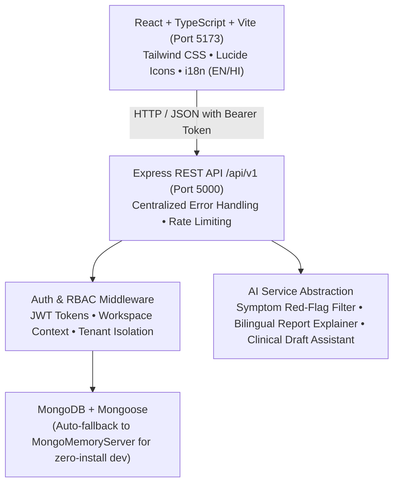

# Swasthya AI (स्वास्थ्य AI)

> **Antigravity Full-Stack Healthcare Access & Coordination Platform**
> *Prepared for Prototype Demonstration & Smart Rewa 2030 Healthcare Vision*

[](https://nodejs.org/)
[](https://www.typescriptlang.org/)
[](https://react.dev/)
[](https://tailwindcss.com/)
[](https://mongoosejs.com/)
[]()

---

## 1. Important Medical & Product Boundary

> [!CAUTION]
> **Prototype Demonstration Notice**:
> This is a healthcare coordination and accessibility prototype, **not** a certified medical device, autonomous diagnostic engine, or replacement for licensed clinician evaluation.
> - All hospital bed numbers, doctor availability, diagnostic values, and pharmacy inventory are **clearly marked as synthetic demo data**.
> - In an acute medical emergency (such as severe chest pain, breathing difficulty, stroke symptoms, or major trauma), users are immediately guided to contact **National Emergency Services (112 / 108)** or proceed to the nearest trauma center.

---

## 2. Architecture & Technical Design



### Core Architecture Components
1. **Frontend (`/client`)**:
   - Modern, calm blue/teal/slate healthcare palette with glassmorphism touches.
   - Dual-language support (**English & हिंदी**) toggled dynamically.
   - Context-driven State Management: `AuthContext` (JWT & active workspace routing), `LanguageContext` (bilingual dictionary).
   - Dynamic **Workspace Switcher** allowing multi-role practitioners (e.g. Doctor practicing at both City Hospital and Private Clinic) to switch operational contexts securely.
   - **One-Click Demo Roles Switcher** allowing instant live evaluation across 12 distinct personas.

2. **Backend API (`/server`)**:
   - Strict REST API versioned under `/api/v1`.
   - Zod schema validation for all requests.
   - Robust RBAC with tenant scoping (`requireRole`, `requireOrganizationAccess`).
   - Server-side double-booking prevention with compound unique indexes.
   - Bed status update validation preventing invalid capacity states (`occupied + available + cleaning + reserved <= totalCapacity`).
   - Gated diagnostic lab report access (patients cannot view results before authorized pathologist release).

3. **Database & Zero-Install Fallback**:
   - Configurable `MONGODB_URI` via `.env`.
   - **Automatic Embedded Fallback**: If no MongoDB server is running locally, the server automatically starts an in-process `mongodb-memory-server` so developers can run, test, and demo without installing external database software.

---

## 3. Quick Start & Execution Guide

### Prerequisites
- **Node.js**: v20 or v22+
- **npm**: v10+

### Step-by-Step Installation

```bash
# 1. Clone or navigate to the repository
cd D:\Swasthya

# 2. Install dependencies across root, server, and client
npm install

# 3. Start both Server and Client concurrently (empty development DB is seeded on server startup)
npm run dev
```

`npm run seed` is for an explicitly configured persistent local MongoDB; it skips populated databases by default. To explicitly reset a dedicated local demo database, use PowerShell:
```powershell
$env:SEED_RESET = 'true'
npm run seed
Remove-Item Env:\SEED_RESET
```
Never run the destructive reset against a real or production database.

The application will be live at:
- **Frontend Web UI**: [http://localhost:5173](http://localhost:5173)
- **Backend API**: [http://localhost:5000/api/v1](http://localhost:5000/api/v1)
- **API Health Check**: [http://localhost:5000/api/health](http://localhost:5000/api/health)

## 3.1 Project Documentation Bundle
The transformation package includes the required documentation set in [docs/](./docs/):
- [docs/DEMO_DATA_AUDIT.md](./docs/DEMO_DATA_AUDIT.md)
- [docs/FEATURE_AUDIT.md](./docs/FEATURE_AUDIT.md)
- [docs/ROLE_PERMISSION_MATRIX.md](./docs/ROLE_PERMISSION_MATRIX.md)
- [docs/IMPLEMENTATION_STATUS.md](./docs/IMPLEMENTATION_STATUS.md)
- [docs/ARCHITECTURE.md](./docs/ARCHITECTURE.md)
- [docs/TEST_REPORT.md](./docs/TEST_REPORT.md)
- [docs/DEPLOYMENT_CHECKLIST.md](./docs/DEPLOYMENT_CHECKLIST.md)
- [docs/WEARABLE_INTEGRATION.md](./docs/WEARABLE_INTEGRATION.md)

## 3.2 Verified status
The current repository is verified to pass the server test suite and the production build:
- `npm test` → passed (39 tests)
- `npm run build` → passed

---

## 4. Automated Testing & Verification

Run the full automated test suite using:

```bash
npm test
```

### Verified Test Cases (39 Passing):
- `Authentication & RBAC`: Invalid login rejection, generic error messages, session verification, admin endpoint permission gating.
- `Healthcare Directory & Freshness`: Bed summaries, updater timestamps, stale data indicators (>12h).
- `Double-Booking Prevention`: Prevents concurrent booking for the same doctor, date, and time slot.
- `Bed Capacity Validation`: Prevents total capacity inconsistencies; verifies authorized updater records.
- `Lab Release Security Gating`: Masks unreleased results from patients; enforces authorized release before patient access.
- `AI Emergency Red-Flag Interception`: Intercepts cardiac and acute symptoms with emergency guidance; verifies non-emergency disclaimers.

---

## 5. Demo Accounts (Local Development & Testing Only)

> **Universal Demo Password**: `Password123!`

| Role | Name & Affiliation | Demo Email | Workspace / Dashboard Path |
| :--- | :--- | :--- | :--- |
| **Patient** | Rahul Verma | `patient@swasthya.demo` | `/dashboard/patient` |
| **Hospital Doctor** | Dr. Sunita Sharma (Cardiologist, SGM Hospital) | `doctor.sharma@swasthya.demo` | `/dashboard/doctor` |
| **Hospital Administrator** | Dr. R.K. Mishra (SGM Hospital) | `hospital.admin@swasthya.demo` | `/dashboard/hospital` |
| **Hospital Bed Manager** | Amit Patel (Inpatient Ward Ops) | `bed.manager@swasthya.demo` | `/dashboard/hospital` |
| **Hospital Receptionist** | Pooja Tiwari (OPD Front Desk) | `hospital.reception@swasthya.demo` | `/dashboard/receptionist` |
| **Staff Nurse** | Sister Anita Singh | `nurse.anita@swasthya.demo` | `/dashboard/hospital` |
| **Private Doctor** | Dr. Manoj Gupta (Rewa Care Clinic) | `private.doctor@swasthya.demo` | `/dashboard/doctor` |
| **Homeopathy Doctor** | Dr. Vivek Saxena (Arogya Homeo) | `homeo.doctor@swasthya.demo` | `/dashboard/doctor` |
| **Pharmacy Owner / Pharmacist** | Suresh Agrawal (Jan Aushadhi Pharmacy) | `pharmacy.owner@swasthya.demo` | `/dashboard/pharmacy` |
| **Diagnostic Lab Admin** | Dr. Sandeep Pandey (Shree Ram Pathology) | `lab.admin@swasthya.demo` | `/dashboard/lab` |
| **Verification Admin** | Neha Chaurasia | `verify.admin@swasthya.demo` | `/dashboard/admin` |
| **Public Health Officer** | Dr. K.P. Sen | `publichealth.admin@swasthya.demo` | `/dashboard/admin` |
| **Platform Super Admin** | System Admin | `superadmin@swasthya.demo` | `/dashboard/admin` |

*(Note: Use the **"One-Click Demo Roles"** menu on the top navigation to switch immediately between any of these accounts!)*

---

## 6. Feature & Role Matrix

| Scope / Role | Feature | Status | Notes |
| :--- | :--- | :---: | :--- |
| **Patient** | Self-registration & Demo Email Verification | **Partial** | Patient-only, local demo token; production disabled until real email delivery exists |
| **Patient** | Health Timeline & Medical Records | **Done** | Chronological record view |
| **Patient** | Appointment Booking & Cancellation | **Done** | Prevents double bookings |
| **Patient** | Digital Prescriptions & Reminders | **Done** | Displays medicines, frequency & advice |
| **Patient** | Gated Lab Report Viewing | **Done** | Withheld until authorized by lab |
| **Patient** | AI Medical Report Explainer | **Done** | Bilingual (EN/HI) normal/abnormal check |
| **Patient** | AI Safety Triage (Red-Flags) | **Done** | Intercepts cardiac/stroke emergencies |
| **Doctor** | Today's OPD Consultation Queue | **Done** | Filtered by doctor assignment |
| **Doctor** | Clinical Visit Notes + AI Draft Assistant | **Done** | Doctor reviews/approves AI draft |
| **Doctor** | Prescription Suite + Allergy Conflict Warning | **Done** | Flags conflict against recorded allergies |
| **Hospital Admin** | Hospital Profile & Staff Management | **Done** | Staff invitation & role assignment |
| **Bed Manager** | Live Bed Board with Freshness Flags | **Done** | ICU, Oxygen, Emergency; Stale flags |
| **Receptionist** | Walk-In Patient Intake & OPD Token Generation | **Done** | Live check-in desk |
| **Pharmacy** | Medicine Inventory & Expiry Tracking | **Done** | Near-expiry (<60d) & low-stock alerts |
| **Pharmacy** | Prescription Dispensing Workflow | **Done** | Recorded dispensing state |
| **Diagnostic Lab** | Sample Lifecycle Tracking | **Done** | Ordered &rarr; Collected &rarr; Processing &rarr; Completed |
| **Diagnostic Lab** | Structured Result Entry | **Done** | Values, units, standard ranges |
| **Diagnostic Lab** | **Authorized Report Release Control** | **Done** | Patient access withheld until release |
| **Verification Admin**| Credential Review & Decision Workflow | **Done** | Inspects statutory licenses; sets badges |
| **Public Health** | Regional Analytics | **Done** | De-identified bed occupancy & load |
| **Super Admin** | Tamper-Resistant Audit Trail | **Done** | Append-only event logging |
| **Ambulance** | Emergency Directory & Demo Request Board | **Mocked** | Explicitly non-live emergency directory |
| **Teleconsultation** | Real-Time Video/Audio | **Mocked / Planned**| Configured when WebRTC provider linked |

---

## 7. Manual Smoke-Test Checklist

- [x] **Smoke Test 1: Patient Self-Registration & Verification**
  1. Click "Register", fill in patient details with language preference.
  2. Confirm demo email verification on the simulated verification screen.
  3. Sign in; verify automatic landing on `/dashboard/patient`.
- [x] **Smoke Test 2: Double-Booking Prevention**
  1. Open Doctors Directory; select a doctor and book slot (e.g. `10:00 AM`).
  2. Attempt to book the exact same slot again; verify the `409 Conflict` error dialog.
- [x] **Smoke Test 3: Hospital Bed Board Updates & Stale Flags**
  1. Log in as Hospital Bed Manager (`bed.manager@swasthya.demo`).
  2. Edit ward capacity and save; verify updated counts and live timestamp.
  3. Notice the pediatric ward displays "Stale (>12h)" warning because it was last updated >24h ago.
- [x] **Smoke Test 4: Prescription Allergy Conflict Interceptor**
  1. Log in as Hospital Doctor (`doctor.sharma@swasthya.demo`).
  2. Open patient consultation for Rahul Verma (who has a recorded `Penicillin` allergy).
  3. Try prescribing a medication matching the allergy; verify the alert banner.
- [x] **Smoke Test 5: Lab Report Release Gating**
  1. Log in as Patient; open "Lab Reports". Notice the CMP test is withheld under review.
  2. Log in as Lab Admin (`lab.admin@swasthya.demo`); open the CMP test and click "Authorize & Release".
  3. Re-login as Patient; confirm the completed report is now unlocked with AI explanations!

---

## 8. Integration Status & Production Next Steps

- **AI**: The current deterministic guidance and report template are development-only and explicitly marked as mock output. No live AI provider adapter is implemented. Production endpoints return an unavailable response rather than pretending to call a model.
- **Email/SMS**: Email delivery is not implemented. Production patient signup and organization invitation creation are therefore disabled; the local demo shows a one-time verification/invitation token for testing. SMS is unavailable.
- **Maps**: The directory uses configured/open map data paths; verify provider terms, coverage, request limits, and attribution before production.
- **Wearables**: Web Bluetooth requires a supported browser/device and explicit permission. Apple Health, Health Connect, and vendor APIs require companion apps or provider approval.
- **Payments and emergency dispatch**: No live settlement or dispatch is claimed without provider credentials and end-to-end integration.

### Secure initial Super Admin bootstrap
For a production deployment, configure `MONGODB_URI`, strong JWT secrets, `BOOTSTRAP_ADMIN_EMAIL`, `BOOTSTRAP_ADMIN_PASSWORD` (12+ characters), and `NODE_ENV=production` in the operator environment, then run once:
```powershell
npm run bootstrap:admin --workspace=server
```
The command refuses if a Super Admin already exists. Remove the bootstrap password from the environment after it completes. Never use public signup to create privileged accounts.
